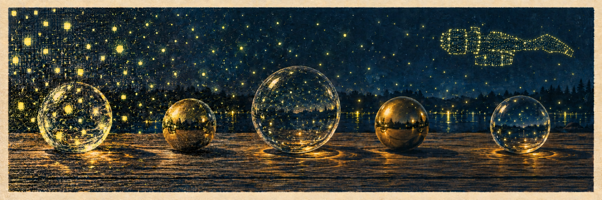

<p align="center">
  
</p>

# Serenity

Serenity is a GPU path tracer I’m building to work through techniques that
also matter to inference: processing work in small pieces, keeping a small
amount of running state, combining partial results, and reusing earlier work.
The scene gives me something visible to judge that work by: 36 glass,
porcelain, and metal marbles on a walnut table, lit by 616 moving fireflies.

It runs natively on Apple silicon through Metal 4 and on NVIDIA’s GPUs
through CUDA and OptiX, in C++20. The goal is a
clean moving image at the display’s full resolution and 60 frames a second,
with the light traced at a lower resolution and brought up to the display’s.

[](https://serenity.plainsight-systems.com/#film)

**Current state: milestone 5.** The same frame now runs on my RTX 3090 Ti,
through CUDA and OptiX, at 174 frames a second at 1920 × 1080 and 50 at
3456 × 2234. The port alone ran at 89; designing the frame for the
3090’s hardware doubled it. Every sphere became a triangle mesh for the
ray-tracing cores, MNEE’s walks run in rounds that keep the GPU’s thread
groups full, ReSTIR PT’s shifts run over lists of pairs, the GPU code is
compiled with fast math as Cycles and pbrt-v4 compile theirs, each
program has its own register limit, the network runs on the tensor
cores’ own shape, and the reservoirs are stored as NVIDIA’s RTXDI stores
them. About as many changes were measured and dropped, among them
Cycles’ wavefront design, which lost on this GPU.

Milestone 4 made the frame fast on the Mac: the fully lit scene runs at
57 frames a second at 1920 × 1080 on my M3 Max, and about 17 at the full
size of its display. Milestone 3 had finished the pipeline; Milestone 4
applied the standard optimizations real-time renderers use once the image
is right. The light and the denoiser run at the same time on two GPU
queues; shadow rays skip the 616 fireflies, which cast no shadow worth
tracing; and each frame traces half the light’s pixels in an alternating
checkerboard, rebuilding the other half from the frame before. A check of
every stage against shipped engines then moved depth of field after the
denoiser, which cleaned up the near marbles, and I retrained the network
on the new input, for the first time on my RTX 3090.

Milestone 3 built the reconstruction. The renderer traces the
light at a quarter of the output’s pixels and hands it to a small neural
network I trained for it. For every output pixel, the network decides how
much each nearby noisy pixel should count, and the pixel becomes their
weighted average. That removes most of the noise ReSTIR leaves and doubles
the resolution each way. I tested it once on the marbles, which it never saw
in training. Measured after tone mapping against 4,096-sample path-traced
frames, the network leaves 0.29 to 0.39 of the raw input’s error, 18 to
38% less than Intel’s Open Image Denoise run on each frame. Once
every firefly is awake, the table’s light also changes more from frame to
frame than the path-traced frames do (36 to 47% more), which I’ve left for
a training round aimed at it.

Milestone 2 built the light the network starts from. ReSTIR PT reuses whole
light paths across neighboring pixels and from the previous frame, and
manifold next event estimation (MNEE) finds the light that the glass marbles
focus onto the table. At 1920 × 1080 a frame of the fully lit scene takes
39.8 ms (about 25 frames a second), about what five path-traced samples
cost (40.6 ms), and at that cost it roughly halves the error left after
tone mapping.

[Milestone 2: reusing work with ReSTIR](docs/writeups/milestone-2.md) follows
the decisions, measurements, and connections to inference.
[Milestone 3: turning samples into an image](docs/writeups/milestone-3.md)
covers the denoiser: what it learned from, how it runs in the frame, and
what it still leaves.
[Milestone 4: making the frame fast](docs/writeups/milestone-4.md) follows
where the frame’s time went and what each optimization bought.
[Milestone 5: the frame on an NVIDIA GPU](docs/writeups/milestone-5.md)
covers the port to CUDA and OptiX and the frame designed again for the
RTX 3090 Ti, including what was measured and dropped.
[Milestone 1](docs/writeups/milestone-1.md) records the original baseline.
The design is in [`docs/architecture/`](docs/architecture/README.md).

## Project site

The [project site](https://serenity.plainsight-systems.com/) includes the renderer,
milestone writing, and project background.
To preview it with the hosted media:

```sh
python3 scripts/site.py serve --port 1314
```

Open <http://127.0.0.1:1314/>. Requirements, content editing, verification, and
media configuration are in [web/README.md](web/README.md). Media is hosted on
R2; GitHub Pages serves the site.

## Why I built it

Lighting a scene with thousands of moving lights is a sampling problem. You
can’t trace a ray to every light for every pixel, every frame, so you pick a
few, and the picture is only as good as the picking. ReSTIR (Bitterli et al.,
2020) is the algorithm that made this work in real time: each pixel keeps a
tiny reservoir of light samples and shares it with its neighbors and with the
previous frame. NVIDIA’s *Marbles at Night* demo showed what that looks like,
and it’s the spirit of this scene.

What interests me is underneath. A frame has a hard deadline, about 16 ms
at 60 frames a second.
Meeting it means streaming through work in on-chip memory, carrying a few
bytes of state instead of everything you’ve seen, and merging that state
across neighbors and across time. Those are the same problems I work on in
inference, met from the other side. Serenity is where I get to work on them
with a picture at the end.

So far the renderer has the MIS path tracer as its baseline, ReSTIR PT with
spatial and temporal reuse, MNEE for caustics, and a denoiser of its own.
Milestone 2 started with ReSTIR DI, which reuses direct light alone. It
didn’t pay off in this scene at equal time, because most of what the camera
sees arrives through glass or off metal, so the work moved to reusing whole
paths, and ReSTIR DI has since been removed.

The denoiser is where the connection to attention is closest. For each
output pixel the network produces a score for every noisy pixel around it,
the scores go through a softmax, and the output is the weighted average of
those pixels. As in attention, what the network learned is how to compute
the scores; the scores themselves come from the frame in front of it, which
is why it works on a scene it never saw. The correspondence has limits: the
neighborhood is a small, fixed window (3 × 3 at three spacings), and the
values being averaged are the noisy colors themselves, not learned
projections. I trained it in PyTorch on scenes generated for the purpose and
run it every frame in the renderer’s own Metal compute kernels, which match
PyTorch to a few parts in ten thousand.

Serenity runs on each vendor’s own API: Metal on the Mac, and now CUDA
and OptiX on my RTX 3090 Ti. Next come HIP with HIPRT for AMD’s Strix
Halo, and Direct3D 12 for the Xbox Series X. The reuse passes come after
that, treated as kernels and tuned for each GPU, since where the time and
the bytes go when reservoirs merge depends on the hardware.

Serenity is R&D under Plainsight Systems LLC.

### Why Serenity

In path tracing, the bright stray pixels that light up a noisy render are
called fireflies. Half the work of a renderer like this one is getting rid of
them, by sampling better and then by denoising. In this scene they're also,
literally, the lights.

So the project is named for what's left when the fireflies are gone: a calm,
clean frame. Noise in, serenity out.

If the name also brings to mind a small ship that kept flying, that's not an
accident, and any Browncoat reading this caught it a paragraph ago. It's why
the metal spheres are polished: they had to be shiny.

## Run it locally

You need an Apple silicon Mac, Xcode 26.2 with its Metal toolchain, CMake
4.2.3, and Python 3.9 or later. Apple's M3 and later trace rays in hardware; earlier
Apple silicon runs the same code in software.

```sh
git clone --recurse-submodules https://github.com/plainsight-systems/serenity.git
cd serenity
make test     # builds, then runs the tests, the GPU tests among them
make check    # structural rules, and tests proving each check fires
make format   # Google style (LLVM 21: brew install llvm); VS Code does it on save, with clangd
make run      # the window, running graphs/test_pattern.toml
make headless # the same frames, as 60 PNGs in frames/
```

The current renderer is ReSTIR PT and MNEE, denoised and upscaled by the
network: the light is traced at half the window’s resolution each way, half
of those pixels each frame in an alternating checkerboard, and the network
brings it to every pixel. It reads the trained network from
`../serenity-data/denoiser-v2-model/wide`, beside the checkout. The weights
aren’t committed; `make weights` downloads them from the project’s media
host and checks every file against its pinned checksum.

```bash
make weights
make run GRAPH=graphs/restir_pt_denoised.toml SCENE=scenes/marbles.toml
```

To make them yourself, [`training/README.md`](training/README.md) covers the
whole cycle, from rendering the data set (four hours on my M3 Max) and
training (3.5 hours on an RTX 3090, about eight on the M3 Max) to the
export.

To compare with the MIS path tracer:

```bash
make run GRAPH=graphs/path.toml SCENE=scenes/marbles.toml SCALE=0.5
```

`graphs/restir_pt_features.toml` and `graphs/features.toml` write the
denoiser's inputs for training, through the headless renderer’s
`--features`.

`serenity-headless` writes into its `--out` directory only if it is new or
empty, and refuses one that holds anything, so no earlier run's frame sits
beside this run's; `make headless` clears its own frames from `frames/`
first.

`make run GRAPH=graphs/other.toml` runs another frame graph, and `SCENE=` gives
it a scene. The marbles are written by `scripts/make_marbles.py`; edit the
scene there. The first lit scene, a soft brass sphere on a checkerboard at
night lit by two fireflies, through the path tracer, which converges while
the image holds still:

```bash
make run GRAPH=graphs/path.toml SCENE=scenes/brass_sphere.toml
```

The fireflies awake, each drifting about where it hung. Through the path
tracer the window starts over every frame while they move, so it shows one
noisy sample of each instant, without accumulating earlier instants:

```bash
make run GRAPH=graphs/path.toml SCENE=scenes/brass_sphere_wander.toml
```

`SCALE=0.5` renders at half the window's resolution each way, for speed.
The display paces the window, at 60 frames a second at most, through a
Metal display link, and a window that is hidden renders nothing.
Escape or closing the window ends it. `make movie` with the same `GRAPH` and
`SCENE` renders ten seconds headless, `SAMPLES` samples of each frame's
instant (64 unless given), and encodes them with ffmpeg into `media/`, which
git ignores.

A reference image, and the path tracer’s convergence toward it:

```bash
make reference SCENE=scenes/marbles.toml TIME=120    # some ten minutes of GPU
make convergence SCENE=scenes/marbles.toml TIME=120  # error, and error x time
```

Both write into `.cache/references/`: the reference as a PFM, and a CSV of
mean squared error and error x time at 1, 2, 4 ... 16,384 samples.
`serenity-measure` does the arithmetic, on the CPU, from the headless
renderer's float images.

The build is pinned to one toolchain. Metal can't run in a container, so the
versions of Xcode, the SDK the build compiles against, the Metal compiler,
Apple's clang (as the C, C++ and Objective-C compiler) and CMake are recorded
in [`cmake/toolchain.json`](cmake/toolchain.json), and configuring the build
stops if yours differ. Shaders are compiled when the project builds and
compiled into the binary. The first build fetches metal-cpp, SDL3, toml++,
stb_image_write and doctest, each pinned by commit or by checksum.

The denoiser’s training is optional and pinned separately. `training/` is
its own Python environment, Python 3.12.15 and PyTorch 2.14.1 through
[uv](https://docs.astral.sh/uv/), every package locked by version and hash
in `training/uv.lock`. Nothing the renderer builds or runs depends on it;
you need it only to make or change the network. Its data and models live
in `../serenity-data/`, beside the checkout, and are never committed.

### On an NVIDIA GPU

The CUDA backend builds on Linux with an NVIDIA GPU of the Ampere
generation (sm_86) or later. Mine is an RTX 3090 Ti on Ubuntu 24.04 with
driver 595.91.07, CUDA 13.2, Ubuntu's clang 18, CMake 3.28 and its Vulkan
headers (libvulkan-dev, for the window), versions recorded in
[`cmake/toolchain.json`](cmake/toolchain.json) as the Mac's are. OptiX's
headers are fetched at configure time; its runtime comes with the driver.
The same targets build and test it:

```sh
make test     # the core's tests, and the CUDA tests on the GPU
make weights
make headless GRAPH=graphs/restir_pt_denoised.toml SCENE=scenes/marbles.toml
make window GRAPH=graphs/restir_pt_denoised.toml SCENE=scenes/marbles.toml
```

`make window` starts its own X server on the monitor through `xinit`, so it
runs from an ssh session too, once X's wrapper allows that
([`docs/research/2026-10-20-cuda-window.md`](docs/research/2026-10-20-cuda-window.md)
lists the packages and the one setting). Escape or Ctrl-C ends it. The
headless renderer's `--times` prints the frame time the write-ups quote.

## Find your way around

| Path | What it holds |
|---|---|
| `src/core/` | the platform-neutral core: what is rendered, how it moves, the frame's schedule, film and output. No GPU or windowing API |
| `src/metal/` | the Metal backend, the only code that touches Metal: the device, and every shader |
| `src/app/`, `src/headless/` | the two ways to run a frame: in a window, or to files |
| `src/measure/` | the measuring program: a reference made from files, and images judged against it |
| `scenes/` | scene descriptions, as data: what is rendered |
| `graphs/` | frame graphs, as data: which passes a frame runs |
| `cmake/` | the toolchain pin, and how shaders are compiled into the binary |
| `tests/` | tests; `tests/gpu/` runs on this machine's GPU |
| `tools/` | the toolchain and boundary checks |
| `scripts/` | scene generation, the denoiser's data set, the project-site build, and independent review of a commit |
| `training/` | the denoiser's training toolkit, in PyTorch: its own pinned environment, outside the C++ build |
| `web/` | the Hugo site’s templates, styles, and hosted-media manifest |
| `docs/architecture/` | the design, written before the code it describes: start with the [logical overview](docs/architecture/logical-overview.md) |
| `docs/research/` | measurements and investigations, each dated, with the machine and toolchain it ran on |
| `docs/writeups/` | what each milestone taught me, for the interested engineer |
| `docs/process/` | decisions and the work queue |

The rule that shapes the layout: the core never knows which GPU it runs on.
Only `src/metal/` uses Metal, and the CUDA backend sits beside it as
`src/cuda/`, so both machines render the same scene from the same core.
`make check` enforces it.

## Credits

- ReSTIR: Benedikt Bitterli, Chris Wyman, Matt Pharr, Peter Shirley, Aaron
  Lefohn and Wojciech Jarosz, "Spatiotemporal reservoir resampling for
  real-time ray tracing with dynamic direct lighting," SIGGRAPH 2020.
- *Marbles at Night*, NVIDIA's 2020 RTX demo, for showing what many moving
  lights on simple geometry can look like.
- pbrt-v4, by Matt Pharr, Wenzel Jakob and Greg Humphreys: the MIS path
  tracer follows its PathIntegrator.
- Lin, Kettunen, and Wyman’s *ReSTIR PT Enhanced*, for the path-reuse
  implementation.
- Blender Cycles’ manifold next event estimation, for the approach to
  finding caustic paths through glass.
- Intel’s Open Image Denoise, for the training’s loss, augmentation and
  schedule, and as the denoiser’s comparison; Thomas et al. (Intel, 2022),
  for denoising and upscaling in one kernel-predicting network; Chaitanya
  et al. (NVIDIA, 2017), for the temporal loss; NVIDIA’s NRD, for the
  motion-vector and albedo conventions.

## License

Code is licensed under the Apache License 2.0; documentation, prose and
original visual assets under CC BY 4.0. See [`LICENSE`](LICENSE) for the
split, and [`NOTICE`](NOTICE) for third-party components and their licenses.
