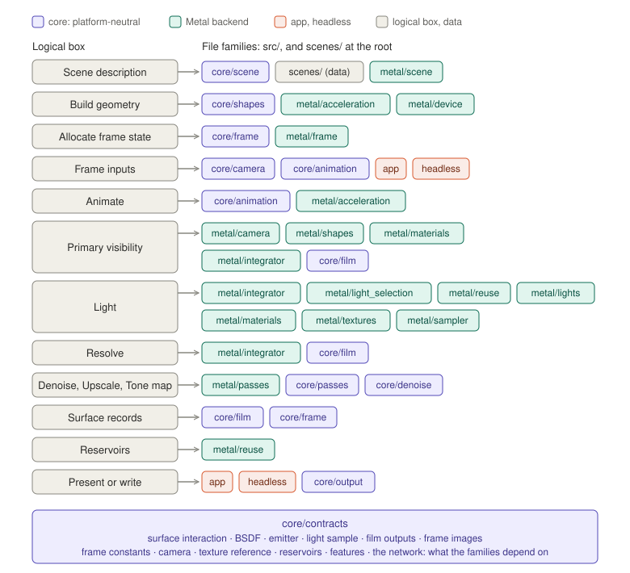

# File mapping

How the boxes in [`logical-overview.md`](logical-overview.md) become files,
applying the axes in [`change-axes.md`](change-axes.md): the algorithm laid
over the axes, which gives the file families.

It fixes the layers, the families and the direction of dependencies, and
it names the contracts between families. It was written before the code,
when the directories were empty; it does not define the contracts or list
the kinds: each contract is designed in its own header before the code that
uses it, and each kind arrived with the change that first needed it.

## Layers

- **The core, `src/core/`,** is platform-neutral C++: the scene, its kinds'
  parameters, animation, the frame's schedule, film, output and measurement.
  It uses no GPU or windowing API.
- **The Metal backend, `src/metal/`,** is the only code that uses Metal: the
  device, acceleration structures, and every shader with the host code that
  launches it. A Vulkan backend will sit beside it, as `src/vulkan/`.
- **The app, `src/app/`, and the headless renderer, `src/headless/`,** are
  the two ways to run a frame: in a window, with the measured clock, or to
  files, with a fixed step.
- **The measuring program, `src/measure/`,** makes a reference from the
  headless renderer's files and judges images against it, on the CPU, with
  the core alone.
- **Scene descriptions, `scenes/`,** and **frame graphs, `graphs/`,** are
  data, at the repository root, in separate files: what is rendered, and
  which passes render it, so one scene runs under any graph.
- **The denoiser's training, `training/`,** is outside the build: a Python
  toolkit, PyTorch, with its own pinned environment (`training/uv.lock`).
  No CMake target, test or graph depends on it. What it hands the renderer
  is a file: the trained network, exported as weights and their layout,
  which the core reads and checks at start-up.
- **Data and models live beside the checkout,** never in it:
  `../serenity-data/` holds the denoiser's data set (`denoiser-v1`, 32.3
  GB, rendered by `scripts/make_denoiser_dataset.py` with a manifest of
  every file's checksum), the training runs, and the exported network
  (`denoiser-v1-checkerboard-model/wide`), which the denoised graph names by a path
  relative to `graphs/`.

Dependencies point one way: the app and the headless renderer depend on the
backend and the core, the measuring program on the core alone, the backend
on the core, and the core on nothing platform-specific. Nothing in
`src/core/` uses a platform API or includes from a backend or a program,
and the measuring program includes from no backend;
`tools/check_boundaries.sh` enforces both, and `make check` proves each
rule fires.

## Composition

No family knows a feature. A feature is a composition of kinds from several
families, made in the scene description:

- **A firefly** is a sphere *shape*, a sphere *light*, a flight-path
  *animation*, and its color, intensity and path in the scene's data.
- **A glass marble** is a sphere *shape* wearing a dielectric *material*.
- **The table** is a box *shape* wearing a rough *material* whose color comes
  from a wood *texture*.
- **ReSTIR PT** is the *integrator*'s paths, their direct light taken at
  every vertex, reused whole through *sample reuse*, which the
  *integrator* shifts from one pixel or frame to another.
- **Manifold next event estimation** is the *integrator*'s strategy for
  light through glass, solved by a *pass* of its own from a work list.
- **The denoiser** is a *pass* reading the radiance and the *film*'s
  features, its trained weights data read by the core, its history kept by
  the *frame graph*.
- **The reference** is the same integrator with reuse switched off,
  accumulating on the *film*.

Adding a firefly to the scene, or a new kind of thing that glows, changes
data or adds a kind; it does not change a family that already exists.

## The families

| Directory | Axis | Holds |
|---|---|---|
| `src/core/contracts/` | contract | the interfaces between axes (below) |
| `src/core/scene/` | Scene content | reading a scene description into its kinds |
| `src/core/animation/` | Animation | each motion kind, placing an object or light at *t*, and each glow kind, setting a light's brightness at *t* |
| `src/core/camera/` | Camera | each camera kind's parameters, and its pose at *t* |
| `src/core/shapes/` | Shape | each shape kind's parameters, bounds and geometry for the acceleration build |
| `src/core/materials/` | Material | each material kind's parameters |
| `src/core/textures/` | Texture | each texture kind's parameters |
| `src/core/lights/` | Light | each light kind's parameters |
| `src/core/media/` | Medium | each medium kind's parameters |
| `src/core/film/` | Film | what a pixel accumulates and outputs |
| `src/core/sampling/` | Sampler | static sampling data the CPU builds: ReSTIR PT's pairing textures |
| `src/core/passes/` | Pass | each pass's settings as a frame graph writes them, and what the tone map computes |
| `src/core/denoise/` | Pass | the denoiser's trained network, read from its export and checked against contract 18 |
| `src/core/frame/` | Frame graph | the passes, their order, the images between them, the history kept across frames, and the light and output sizes; reading frame graph files |
| `src/core/output/` | Output | each file format's writer |
| `src/core/measurement/` | Measurement | error against the reference, and timing reports |
| `src/metal/device/` | GPU backend | the device, libraries and pipelines, resources, encoding and synchronization |
| `src/metal/scene/` | Scene content | which of the scene's arrays the GPU holds, and their addresses |
| `src/metal/acceleration/` | Acceleration | building and updating the acceleration structures |
| `src/metal/shapes/` | Shape | each shape kind's intersection and point sampling |
| `src/metal/materials/` | Material | each material kind's BSDF |
| `src/metal/textures/` | Texture | each texture kind's evaluation |
| `src/metal/lights/` | Light | each light kind's emission and sampling |
| `src/metal/media/` | Medium | each medium kind's transmittance |
| `src/metal/camera/` | Camera | each camera kind's ray generation |
| `src/metal/math/` | shared shader math | orthonormal frames, and warps from the unit square to the disk and the hemisphere: mappings every family uses, owned by none |
| `src/metal/film/` | Film | what a pixel accumulates: folding a frame into the mean |
| `src/metal/sampler/` | Sampler | deriving random numbers from pixel, frame and purpose |
| `src/metal/light_selection/` | Light selection | each strategy for choosing a light |
| `src/metal/integrator/` | Integrator | the path loop, its strategies, and the target function |
| `src/metal/reuse/` | Sample reuse | the reservoir, the merge rule, and temporal and spatial reuse |
| `src/metal/passes/` | Pass | each pass, its shader and its launcher together |
| `src/metal/frame/` | Frame graph | running the core's schedule on Metal |
| `src/app/` | Presentation | the macOS window, its event loop and the measured clock |
| `src/headless/` | Presentation | rendering frames to files at a fixed step |
| `src/measure/` | Measurement | the measuring program's command line: a reference made from files, and images judged against it |
| `scenes/` | Scene content | scene descriptions, as data |
| `graphs/` | Frame graph | frame graphs, as data |
| `training/` | outside the build | the denoiser's training toolkit: data loading, the network, the loss, training, the test, the export, and the check of the renderer's pass against PyTorch |

A kind lives in two halves with the same axis and the same name: its
parameters and anything the CPU needs in the core (a sphere's bounds, for
the acceleration build), and its shader in the backend (the sphere's
intersection). The halves change together when the kind changes, and are
kept as a pair, the way a shader and its launcher are.

## The contracts

Each contract has one owner and is read by the families listed; families
depend on contracts, not on each other.

| # | Contract | Owned by | Read by |
|---|---|---|---|
| 1 | **Surface interaction**: position, in the world and the shape's own coordinates, normals, the side arrived from, material, the medium inside; (u, v) with the first texture that needs them | Shape | Material, Texture, Integrator, Sample reuse |
| 2 | **BSDF**: a material resolved at a surface, and evaluate, sample, pdf and lobes on it; and its packed form, 16 bytes, for ReSTIR PT's G-buffer of primary hits | Material | Integrator, Sample reuse |
| 3 | **Emitter**: a direction toward the light drawn from numbers, the radiance along it, the distance to it, the pdf; the radiance it emits; which light, if any, a shape is; and its presampled form, ReSTIR PT's light tiles (`light_tile.h`, 32 bytes an entry) | Light | Light selection, Integrator, Sample reuse |
| 4 | **Light sample**: which light and which point on it, in its own coordinates (`light_sample.h`: the light's record index with a valid bit and the point in two 16-bit numbers, equal-area octahedral for a sphere, 8 bytes, as RTXDI stores them), and what that point gives a surface | Light | Sample reuse, Integrator |
| 5 | **Film outputs**: radiance, normal, depth, motion per pixel; and ReSTIR PT's G-buffer of primary hits, which every shift starts from (`primary_hit.h`, 48 bytes). ReSTIR DI's surface record and path state (`surface_record.h`) were removed with ReSTIR DI, 2026-10-17 | Film | Pass, Sample reuse, Integrator (the shift) |
| 6 | **Frame images**: the images between passes and the history across frames; first, the accumulated image | Frame graph | every Pass |
| 7 | **Frame constants**: the frame's time and index, the size of the image written, and the frames the accumulated image holds | Frame graph | every Pass |
| 8 | **Camera**: where the frame is seen from, and that view framed for an image | Camera | Scene content, Frame graph, every Pass that generates rays |
| 9 | **Texture reference**: which texture a parameter takes its value from, or none | Texture | Material |
| 10 | **Transform**: where an instance of a geometry is, from its own coordinates to the world's | Shape | Animation, Light, Acceleration |
| 11 | **Obstacles**: what a motion must keep clear of, as distances and touches against the still shapes | Animation | Scene content (answers) |
| 12 | **Medium**: what fills a shape's inside, and the share of light a stretch through it keeps | Medium | Integrator; named by Shape |
| 13 | **Linear image**: a rendered image's radiance on the CPU, three floats a pixel, before tone mapping | Film | Output, Measurement |
| 14 | **Reservoir**: ReSTIR DI's light reservoir (`reservoir.h`, RTXDI's packed reservoir); removed with ReSTIR DI, 2026-10-17 | (none) | (none) |
| 15 | **Path reservoir**: ReSTIR PT's one path a pixel by its numbers' stream and its reconnection vertex (a primitive and a point in its own coordinates), its F, contribution weight, count and cached Jacobian (`path_reservoir.h`, 64 bytes, ReSTIR PT Enhanced's Algorithm 1); its settings beside it (`path_reuse_settings.h`) | Sample reuse | Pass, Integrator (the shift), Frame graph |
| 16 | **MNEE's work list**: a request a pixel ReSTIR PT's path loop leaves for the manifold solve where a light's straight segment crosses glass (the receiver, the light sample, the crossings, the weight; 128 bytes), and the list's header: its count, capacity and the solve's indirect grid (`mnee_request.h`) | Integrator | Pass (the MNEE pass), Frame graph |
| 17 | **The denoiser's features**: albedo, world normal, view depth and 2.5D motion a pixel, along the light's own camera rays, through glass and mirrors by primary surface replacement (`features.h`) | Film | Pass (the denoiser), the headless renderer's `--features` |
| 18 | **The denoiser's network as it runs**: its constants (scale 2, 28 input channels, 124 scores, spacings 1, 2 and 4, the albedo floor, the PU transfer), the threadgroup shapes host and shaders share, and its per-frame constants (`denoise.h`) | Pass | the core's loader, the Metal denoise pass, host and shaders |
| 19 | **Ray mask**: the classes of shape, a light or a surface, as bits, and the two masks a ray carries, everything or the occluders (the surfaces), with which purpose of ray carries which (`ray_mask.h`) | Acceleration | Integrator, Pass (the features) |
| 20 | **Checkerboard**: which pixels a denoised frame traces, the packed slot of a traced pixel's reservoir, the traced grid, the frame before's traced pixel beside one, and the fill's constants (`checkerboard.h`) | Frame graph | Sample reuse, Pass (ReSTIR PT's and the fill) |
| 21 | **Depth of field**: the circle of confusion's scale, focus and largest radius for a frame, the half-resolution grid and its tiles, the gather's rings (`depth_of_field.h`) | Pass | the Metal depth-of-field pass, host and shaders; the frame graph, which fills its constants from the camera's lens |

Each is designed on its own, header first, before the code that uses it.
Contract 7 was the first written: `src/core/contracts/frame_constants.h`.
Contracts 8 and 9 came with the first scene: `camera.h` and
`texture_reference.h` beside it. Contracts 1 and 2 came with the path
tracer: `surface_interaction.h` and `bsdf.h`, the shared layouts, with the
functions' semantics stated there and written by each backend; contract 3,
`emitter.h`, with them. Contract 6 starts as one image, the accumulated
mean a converging pass folds its frames into (`metal/frame/accumulation.h`),
and grows into the images between passes when a pass first reads another's.
Contract 13, `linear_image.h`, came with the reference: the radiance Film
hands to Output's files and Measurement's errors. Contracts 4, 5 and 14
came with ReSTIR DI: `light_sample.h`, `surface_record.h` and
`reservoir.h`, with `reuse_constants.h`, Sample reuse's per-frame values,
beside them; contract 6 grew by ReSTIR's records and reservoirs, ping-ponged
across frames (`metal/frame/frame_images.h`); ReSTIR DI's removal
(2026-10-17) took contract 14, contract 5's surface record and
`reuse_constants.h` with it, leaving contract 4 to ReSTIR PT's
reconnections. Contract 15 came with ReSTIR
PT, with contract 3's light tiles and contract 5's G-buffer of primary hits;
contract 16 with manifold next event estimation; contracts 17 and 18 with
the denoiser, the frame graph keeping the feature images and the
denoiser's history (`metal/frame/feature_images.h`, `denoise_images.h`), and
contract 7 growing by a second ring of constants: a denoised frame's
passes before the denoiser run at the light size, the rest at the output's.
Contract 19, `ray_mask.h`, came with Milestone 4's ray masks, and
contract 20, `checkerboard.h`, with its checkerboard rendering; contract
21, `depth_of_field.h`, with the lens applied after the denoiser.
The camera is one contract for every camera, as Falcor's `CameraData` is,
since a frame has one camera and cameras differ by parameters, not code.

**How a layout crosses into a shader.** The data a contract passes to the
GPU (a material's parameters, a light sample, a primary hit) has one
definition, in a core header that Metal's shading language can also
include: plain fixed-size fields, nothing only the host has. The host writes
the bytes the shader reads, with no second definition to drift. This shares
layouts only, never math. The Vulkan backend's shaders will mirror these
definitions in their own language.

## The algorithm over the families

The per-pixel work, from primary visibility to tone mapping, lives in the
backend; the core holds what is rendered, how it moves, and the schedule:
the core decides what a frame computes and the backend computes it. Light is the
widest box, and it is the split the change axes insist on: the integrator,
light selection, sample reuse, and the lights, materials and textures it
evaluates, each a family of its own.

## Two queues for a denoised frame

The frame's two halves (`logical-overview.md`, "The frame"; the axes in
`change-axes.md`) land in the families that already own each concern; no
file is new:

| What | Family | File |
|---|---|---|
| the second queue, each frame slot's second command allocator and buffer, the event the light half signals and the image half waits for, a two-part submission's commit and settling | GPU backend | `src/metal/device/submission.{h,cpp}` |
| where the frame splits, the barriers on each side, the hand-off images kept one set per frame slot (the features at both sizes, and the light's radiance, which the checkerboard's fill writes), and how many parts a frame has | Frame graph | `src/metal/frame/renderer.{h,cpp}` |
| the per-slot radiance hand-off | Frame graph | `src/metal/frame/denoise_images.{h,cpp}`, beside the denoiser's other memory |
| asking the renderer for its parts and beginning the submission with them | Presentation | `src/app/main.cpp` through `render_to_window()`, `src/headless/main.cpp` through `render_to_offscreen()` (both in `renderer.cpp`), unchanged themselves |
| a frame's time when frames overlap: from when it began, or the frame before it finished if later, to when it finished | Measurement | `src/core/measurement/frame_times.{h,cpp}` |

The passes (`src/metal/passes/`) do not change: the denoise and tone map
passes record into the image half's encoder as they recorded into the
frame's one.

## Ray masks

Which shapes each ray finds (`logical-overview.md`, principle 11; the axes
in `change-axes.md`) adds one contract and one shared layout, and changes
the families that already own each part:

| What | Family | File |
|---|---|---|
| the classes of shape and the two masks, as bits a two-level structure's instances would carry; which ray purpose carries which (contract 19) | Acceleration (contract) | `src/core/contracts/ray_mask.h`, new |
| a structure for each mask, every shape and the surfaces alone, each built once when nothing in it moves and per frame slot when something does; the surfaces' shape table; the block the shaders bind | Acceleration | `src/metal/acceleration/scene_acceleration.{h,cpp}` |
| the block's shared layout: each structure as a shader binds it, and the table | Acceleration | `src/metal/acceleration/structure_block.h`, new |
| a query by mask: the nearest shape, whether any blocks, and the candidates' shapes for a query of the integrator's own | Acceleration | `src/metal/acceleration/trace.metal.h` |
| each ray's mask, at each site that traces (ReSTIR PT's passes ask through `nee.metal.h` and `mnee.metal.h`, unchanged themselves) | Integrator | `src/metal/integrator/{path,nee,shift,mnee}.metal.h` |
| the features' camera rays: everything | Pass | `src/metal/passes/features/features.metal` |
| the scene's view holding the block, and the kernels binding it where they bound the structure | Scene content, Pass | `src/metal/scene/scene_block.metal.h`, each pass's `.metal`, `src/metal/passes/scene_binding.h`, `src/metal/frame/frame_resources.h` |
| handing the acceleration the shapes that are lights, as it is handed the ones that move | Frame graph | `src/metal/frame/renderer.cpp` |

## Checkerboard rendering

Tracing half the light's pixels a frame, as every denoised frame does
(`logical-overview.md`, "The frame"; the axes in `change-axes.md`), adds
one contract and one pass, and changes the families that own each part:

| What | Family | File |
|---|---|---|
| which pixels frame *n* traces, the packed slot two pixels of a row share, the grid the light's kernels dispatch over, the frame before's pixel beside one, the fill's constants (contract 20) | Frame graph (contract) | `src/core/contracts/checkerboard.h`, new |
| a graph's light checkerboarded exactly when it has the denoise pass, and its spatial reuse's sigma one the traced lattice can pair at | Frame graph | `src/core/frame/schedule.{h,cpp}` |
| whether the light is checkerboarded, as ReSTIR PT's kernels read it | Sample reuse (contract 15's sibling) | `src/core/contracts/path_reuse_settings.h` |
| each kernel's pixel and slot through the contract; the spatial partner over the traced lattice; the temporal input in the other field | Pass, Sample reuse | `src/metal/passes/restir_pt/restir_pt.metal.h`, each `src/metal/passes/restir_pt_*/*.metal`, `src/metal/reuse/pairing.metal.h` |
| the light's kernels dispatched over the traced grid | Pass | each `src/metal/passes/restir_pt*/*.cpp`, `src/metal/frame/frame_resources.h` |
| the fill: the hand-off written from the traced half and the frame before's | Pass | `src/metal/passes/checkerboard_fill/`, new |
| the fill's history, every pixel's handed-off light and depth, two by the frame's parity | Frame graph | `src/metal/frame/checkerboard_images.{h,cpp}`, new |
| the fill writing the hand-off, the frame before's slot, the reuse textures over the lattice | Frame graph | `src/metal/frame/renderer.{h,cpp}` |

Contract 20 is the one place the field and the packing are written, read
alike by the host's dispatches and every kernel, so no two can disagree
about which pixel a thread or a slot is.

## Depth of field after the denoiser

The lens applied after the network (`logical-overview.md`, principle 12;
the axes in `change-axes.md`) adds one contract and one pass, and changes
the families that own each part:

| What | Family | File |
|---|---|---|
| the depth-of-field pass's kind and its place, directly after the denoise pass and before the presenting pass; a denoised graph's light traced through the pinhole of its camera (`traced_inputs`) | Frame graph | `src/core/frame/schedule.{h,cpp}` |
| the circle of confusion a thin lens gives a depth, in pixels of an image | Camera | `src/core/camera/thin_lens.{h,cpp}` |
| the pass's constants, grid, tiles and rings (contract 21) | Pass (contract) | `src/core/contracts/depth_of_field.h`, new |
| the blur: presort to half resolution, tiles of the largest near radius, their dilation, the gather, the median, the composite | Pass | `src/metal/passes/depth_of_field/`, new |
| its half-resolution images and tile buffers | Frame graph | `src/metal/frame/depth_of_field_images.{h,cpp}`, new |
| the camera traced through a pinhole in a denoised graph; the pass recorded in the image half with the full-size depth and its constants | Frame graph | `src/metal/frame/renderer.{h,cpp}`, `src/metal/frame/frame_resources.h` |
| the data set's scenes written without a lens | outside the build | `scripts/make_denoiser_dataset.py` |

## Not here yet

- **The Vulkan backend.** It arrives as `src/vulkan/`, mirroring
  `src/metal/`'s families, when the AMD machine's milestone comes. The
  denoiser's kernels are to be written for it too, on Vulkan's cooperative
  matrices (`docs/research/2026-10-15-denoiser-live.md`), reading the same
  exported weights through the same core loader.
