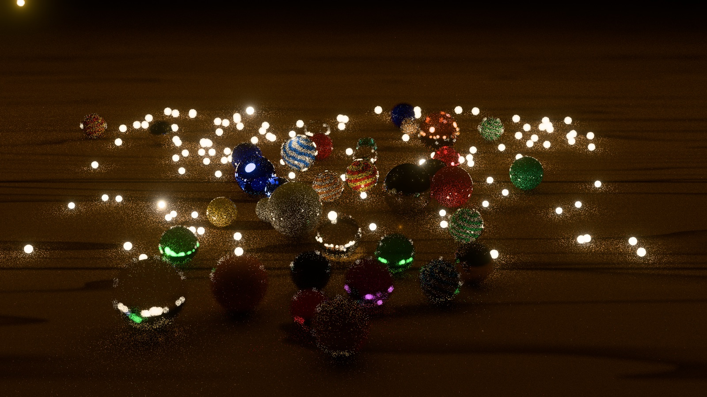

# Milestone 1: building the baseline

*Ten seconds into the opening: 36 marbles on a walnut table, lit only by
fireflies. Naive path tracer, 64 samples a pixel, 1920 × 1080.*

I’m building Serenity to work through GPU questions from the rendering side.
In inference, I spend time thinking about how to process data in small pieces,
carry less state, and combine partial results without moving everything back
to memory. A renderer makes me ask related questions, with an image at the
end that lets me see what the kernel work makes possible.

The scene is a table of marbles lit by hundreds of moving fireflies. There
are far more light paths than I can afford to trace in a frame, so choosing
which ones to sample matters. Eventually I want to choose and reuse those
samples with ReSTIR. Its reservoirs keep a small amount of running state,
which is part of what interests me about the connection to attention kernels.
The estimators and operations differ; I’m looking at what transfers in the
way the GPU work is organized.

First I needed a path tracer to compare that work against. Milestone 1 is
that baseline: the scene, a straightforward estimator, a reference image,
and a way to measure both error and time. Getting those in place took me
through rather more measurement and correctness work than I expected.

These are the milestone-one results on my Apple M3 Max, using C++20 and
Metal 4. They describe the October 10 baseline, before the sampling work on
the next branch.

| Measurement | Milestone-one result |
|---|---|
| Frame at 3456 × 2234, every firefly awake, t = 120 s | 29.90 ms |
| Frame at the same resolution, opening still dark | About 19.1 ms |
| Reference at 1920 × 1080, 65,536 samples a pixel, t = 120 s | 9 min 27 s |
| MSE × seconds at 1920 × 1080, t = 120 s | About 1.3 to 3.2 across the measured runs |

The frame timings tell me how much work fits into a frame. The error-and-time
measure asks a different question: how much rendering time does it take to
get a useful image? That is the comparison I’ll need when a better sampling
method costs more per sample. I explain the measure [below](#why-multiply-error-by-time).
The film on the homepage is an offline render played back at 30 frames a second;
its playback rate is not the speed at which these frames were rendered.

## Choosing a scene to learn from

I chose the scene before optimizing the renderer because I wanted the work
to be driven by what the image needed. There are 36 marbles at real scale,
seen through a macro lens: clear and tinted glass, cat’s-eyes with swirled
cores, porcelain under a clear coat, and brass, steel, and copper. Each
material gives the light something different to do. The 616 fireflies fly
in two swarms, on loops checked clear of the scene’s surfaces at load time.

The opening starts in darkness. Fireflies perched on the table and marbles
wake one at a time and rise, while the other swarm comes down from above.
That began as an art decision and became a useful test of the sampler. The
naive path tracer picks uniformly from all 616 lights. Early in the opening,
almost every light it picks is still asleep, so most of those choices
contribute nothing. A sampler that directs more work toward the lights that
matter has a clear opportunity here.

Before trying a better sampler, though, I found work the existing one did
not need to do. My kernel traced a shadow ray toward the chosen light even
when that light was dark. The ray could not change its contribution of zero.
The pbrt-v4 implementation I was following checks the light sample’s radiance
first. Adding that check left the pixels unchanged and made the opening
considerably cheaper.

| Time into the scene | Without the check | With it |
|---|---|---|
| 0.5 s, no light awake | 32.35 ms | 19.16 ms |
| 8 s, a few awake | 32.45 ms | 24.34 ms |
| 120 s, all awake | 29.89 ms | 29.77 ms |

That was useful preparation for the later comparisons. I wanted to measure
what better sampling bought, without giving it credit for an avoidable
shadow ray in the baseline.

## Finding where the frame goes

I tried two designs from production renderers before I understood my own
bottleneck. Both made this scene slower.

Apple’s primitive data stores records inside the acceleration structure,
close to where ray tracing uses them. That can save reads from separate
per-primitive buffers. In Serenity it added 0.2 to 0.3 ms a frame. My scene
had only a few hundred shape records, already read through Metal’s constant
address space. The cost being removed in a large triangle scene was not a
large part of this one.

I also tried a two-level acceleration structure, the arrangement used to
build a mesh once and place instances of it around a scene. For my exact
spheres, that took 18.1 ms against 8.2 ms for a single level of placed
bounding boxes. A mesh can have thousands of triangles worth building a
structure around once. An analytic sphere needs much less machinery, and
the extra level cost more than it saved in this test.

A third change, putting the scene arrays behind one bindless block, initially
made the five-sphere test 9.5% slower: 16.18 ms against 14.77 ms. Here the
problem was partly how long I kept things alive. I had built views of the
scene once and carried their pointers through the whole path. Constructing
the views where they were used saved 0.6 ms. Moving the block from `device`
to `constant` memory, as in Apple’s bindless example, saved another 0.5 ms
and brought it within 2% of the original.

The hardware counters finally gave me a better account of the marbles frame.

| Counter | Marbles scene |
|---|---|
| Ray-tracing unit active | 93.5% |
| Kernel occupancy | 22.3% |
| L1 eviction rate | 91% |
| L1 residency from ray-tracing scratch / registers | 48.7% / 23% |
| ALU utilization | 13.9% |

The ray-tracing unit was busy while relatively few threads were resident.
Much of L1 held ray-tracing scratch and registers, and arithmetic utilization
was low. Together, those observations pointed toward ray traversal and the
state kept alive across ray queries. Moving the small scene records around
was unlikely to address most of that cost.

Carrying less state across a query was a promising next experiment. So was
splitting tracing and shading into separate kernels, usually called wavefront
path tracing. Neither gain followed automatically from the counters; both
would need measuring. At this milestone I kept the straightforward kernel
so I could first compare the sampling changes against a stable baseline.
The [counter recording](https://github.com/plainsight-systems/serenity/blob/main/docs/research/2026-10-10-corpus-sweep.md)
and the notes on [primitive data](https://github.com/plainsight-systems/serenity/blob/main/docs/research/2026-10-10-primitive-data.md),
[acceleration structures](https://github.com/plainsight-systems/serenity/blob/main/docs/research/2026-10-09-acceleration-structure.md),
and the [scene block](https://github.com/plainsight-systems/serenity/blob/main/docs/research/2026-10-10-scene-block.md)
record what each experiment changed.

## What the image did not tell me

A review against the C++ Core Guidelines and the project’s performance
guidelines produced 419 findings. Those were findings to assess, including
conventions and rejected suggestions, rather than 419 confirmed bugs. But
several substantial defects had survived behind quite plausible images.

A `double` was converted to a 64-bit integer before its range check, so a
number accepted from a scene file could reach undefined behavior. Shader
rays ended at `INFINITY` despite being compiled with fast math, which assumes
infinities do not occur. On an error during a run, buffers could be freed
while two frames still used them: the object responsible for waiting for
the GPU was destroyed after the objects it needed to protect.

There were problems in the image calculation too. Russian roulette, which
ends some paths early to keep their cost bounded, was terminating paths
inside glass too often. Correcting that behavior cost 0.9 ms a frame. The
random-number keys also allowed thousands of pixel pairs to share a key in
a frame. Neither issue announced itself as a broken renderer.

The tests needed attention alongside the implementation. Five could not
fail as written. The review fixes included deliberately breaking the code
a test was meant to protect and checking that the test then failed. That
made the checks useful evidence for the fixes, including the error path
where GPU work was still in flight.

Trying inputs beyond the chosen scene seeds exposed another assumption.
Of 30 alternative seeds for one swarm, 14 refused to load because a single
firefly’s flight could not be drawn clear of the geometry. Six failures
predated the changes being tested. The existing scene had loaded because
its seeds happened to work. The loader now redraws a refused firefly from
the next seed, preserving the original result whenever the first draw works.

The reference-image work found a similar boundary in sample indices. The
batch renderer accepted 64-bit indices, but the shader used only their low
32 bits to key its random numbers. Starting a batch past that range would
silently repeat samples. Such a run is now rejected before rendering. Those
cases mattered because I was about to rely on separately rendered batches
as independent measurements.

## Making the timings reproducible

My first baseline, 28.44 ms, came from a measurement harness I had not
committed. When I needed to reproduce it, I could not. I rebuilt the harness
and wrote down the method: two frames in flight, as in the window; 200 frames;
the median of frames 21 through 199; and an otherwise idle GPU. On the old
code that gave 28.60 ms, within 0.6% of the earlier result. The agreement was
reassuring, and this time the method was there to run again.

The moving scene needed another part of the measurement stated explicitly.
A dark frame cost about 19 ms and an awake scene about 30 ms, so a timing
without the scene time was ambiguous. I fixed the baseline at 120 seconds,
when every firefly was awake, and recorded opening measurements separately.

I had also left a renderer window running during one set of measurements.
Everything looked roughly twice as slow. A bisect only made sense once the
baseline commit turned out to have “regressed” too. Checking for other GPU
work became part of preparing a timing run.

Some changes that sounded straightforward were just as dependent on a
measurement. Removing the barrier between frames allowed overlap, but the
frames contended and took 67 to 79 ms instead of 27.7 ms. Scene loading went
the other way: a profile put 92% of its cost in a distance query that placed
every still shape again on every call. Placing those shapes once at load
reduced loading time from 459 ms to 124 ms. These results are specific to
this renderer and machine, but the recorded methods let me revisit the
choices as the workload changes.

## Measuring error in an image that is still noisy

For the reference, I froze the scene and rendered many samples with the same
path tracer. That gives later estimators a common image to compare against,
although it does not independently establish that the shared light-transport
code is correct. The closed-form GPU tests serve that part of the work.

To measure the difference, I subtract the reference from the rendered image,
square each red, green, and blue channel’s difference, and average those
squares over the image. That is mean squared error, or MSE. Squaring prevents
an overly bright pixel from cancelling an overly dark one, and gives larger
mistakes more weight. I measure the light values before tone mapping, so a
display transform cannot hide an error by compressing a bright value. MSE
tells me how closely the calculated light matches the reference; it does not
capture everything a person notices when looking at the picture.

Accumulating the reference needed more care than increasing the sample count.
The GPU stores each pixel’s running mean in 32-bit floats. Around 65,536
samples, updates from samples within roughly 0.4% of the mean can disappear
into rounding. I rendered 64 batches of 1,024 samples and combined them on
the CPU in double precision. Metal has no double-precision shader type.

The more difficult problem was the distribution of the samples. Two
references made from disjoint sample ranges agreed in mean brightness to
within 0.08%, yet about 95% of their squared difference came from only 0.01%
of the pixels, roughly 200 pixels in a two-million-pixel image. Rare, very
large contributions still dominated those pixels after 65,536 samples.
Agreement in the overall mean did not prove the estimator unbiased, and it
did not make either reference exact.

That explains why the convergence measurements were uneven. Doubling the
samples could introduce a rare bright contribution and send the measured
error upward before it fell again. Even the estimated error in the reference
was too optimistic when checked against the second reference.

## Why multiply error by time?

A lower MSE by itself does not tell me whether a new sampling method is an
improvement. I can usually lower the old method’s error by letting it render
longer. Comparing at the same sample count is not enough either: ReSTIR has
to choose candidates and reuse earlier samples, and that work takes time.
What I want to know is whether spending time on that machinery buys a better
image than spending the same time tracing more ordinary paths.

Consider an illustrative comparison. The naive method takes one second to
render 1,000 samples and has an MSE of 0.010. A new method takes two seconds
for the same sample count and has an MSE of 0.004. At first that looks like
2.5 times less error. But the naive method could use those two seconds to
render 2,000 samples. If its error halves as expected, it would reach 0.005.
The new method’s advantage at equal time is then 20% less error. Its samples
are better, but some of that gain pays for their extra cost.

Multiplying MSE by rendering time expresses that tradeoff in one number.
The naive method scores 0.010 × 1 = 0.010 MSE-seconds; the new method scores
0.004 × 2 = 0.008. The smaller product corresponds to the same 20% advantage.
If the new method instead took three seconds, its product would be 0.012.
Despite making a cleaner image at the same sample count, it would lose this
comparison: the naive method could make better use of those three seconds.

The reason the multiplication works comes from averaging. For independent,
unbiased samples with finite variance, the expected squared error of their
average falls in proportion to the number of samples. Here, unbiased means
the estimate is correct on average over repeated runs; it does not mean any
one noisy image is correct. If the variation in one sample is *V* and I
average *N* samples, the expected MSE is *V / N*. If each sample costs *c*
seconds, the rendering time is approximately *N × c*. Multiplying gives:

**MSE × time ≈ (V / N) × (N × c) = V × c**

The sample count cancels. That leaves the two things I want a sampling method
to improve: how much variation its samples introduce, and how much they cost.
Under these assumptions, halving the product means roughly half the error
at a fixed rendering time, or half the time to reach a fixed error. This is
why a slower kernel can still be the better renderer: it may reduce the
number of samples needed by more than it increases their cost.

The assumptions also tell me where to be careful. A reference image has its
own error; once a render gets close to that floor, more time will not keep
reducing the measured difference in the same way. Bias can leave a persistent
error too. Setup costs matter in short runs, and reused samples are no longer
independent. For ReSTIR I’ll need to measure the actual equal-time results,
rather than assume this simple scaling law holds.

Even the naive method does not produce a steady score in every finite run.
Those rare bright contributions make the measured error fluctuate. Multiplying
by time does not smooth them away, as the milestone-one results show:

| Samples, t = 120 s | MSE | MSE × seconds |
|---|---|---|
| 1,024 | 0.211 | 2.0 |
| 2,048 | 0.0707 | 1.35 |
| 4,096 | 0.0335 | 1.28 |
| 16,384 | 0.0211 | 3.2 |

These error measurements use 1920 × 1080 runs and their elapsed time, not
the 3456 × 2234 frame-time figure above. The score rises from 1.28 to 3.2
between the last two rows even though the MSE falls: the longer run costs
four times as much without reducing the measured error by a factor of four.
That spread is why I cannot treat a small difference between two isolated
scores as a reliable win. I need to look at the convergence measurements and
the equal-time images alongside the product.

## What I’m taking into the next milestone

Early in the work I required CPU and GPU math to be bit-identical so I could
check shaders against C++. I dropped that requirement the same day. It was
constraining the renderer’s math to fit the test rather than testing what I
needed the renderer to do. The GPU is now checked against closed-form answers
and reference renders, at the place where the results will actually be used.

I’m also keeping the unsuccessful experiments and their measurements. If a
larger scene eventually makes a two-level structure worthwhile, I want to
know why the earlier version lost and what has changed since.

The next work is ReSTIR, in progress on a branch. I want to see whether
choosing and reusing light samples reduces error enough to pay for the extra
work, particularly in the opening when most lights are still dark. Milestone
1 gives me the renderer, the scene, and the measurement tools to ask that
question. The numbers here remain the historical baseline; later changes to
the estimator need their own measurements.

*The [research notes](https://github.com/plainsight-systems/serenity/tree/main/docs/research)
keep the experiments, configurations, and results behind this writeup.*
