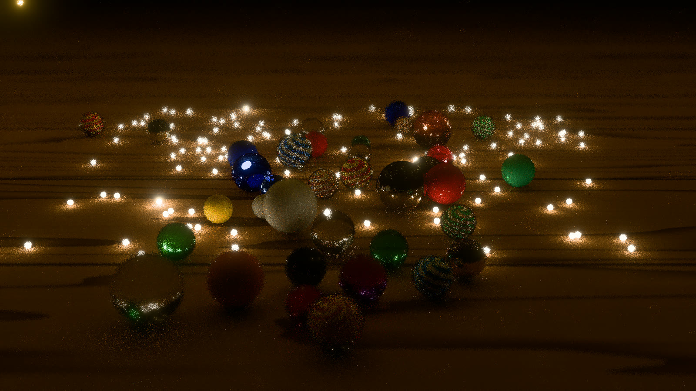
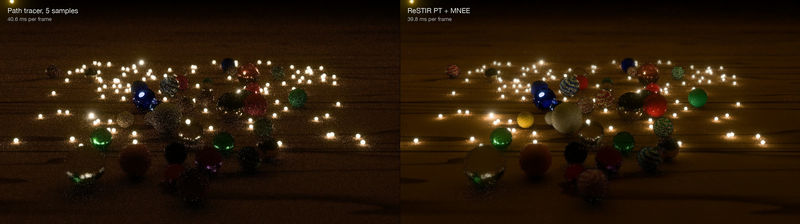

# Milestone 2: reusing samples with ReSTIR

*Ten seconds into the opening, one frame as the renderer shows it: ReSTIR PT
with manifold next event estimation, one path a pixel, 1920 × 1080, 39.8 ms.*

Milestone 1 gave me a path tracer, a reference image and a way to measure
error against time. Milestone 2 was about the reason I built it: reusing
samples with ReSTIR, and seeing how much of the way it organizes GPU work
carries over from attention kernels.

The short version is that it works, but not the way I first planned it. The
first ReSTIR I built was the wrong one for this scene, and finding out why
taught me more than getting it right would have.

These are the results on my Apple M3 Max at 1920 × 1080. The path tracer is
given as many samples a pixel as fit in ReSTIR's frame time, so each column
compares one frame each at the same cost.

| Region of the frame | Path tracer, 5 samples (40.6 ms) | ReSTIR PT + MNEE (39.8 ms) | Error ratio |
|---|---|---|---|
| Whole frame, t = 120 s | 0.0116 | 0.0060 | 1.9× lower |
| Porcelain marbles | 0.0163 | 0.0061 | 2.7× lower |
| Table | 0.0080 | 0.0028 | 2.9× lower |
| Glass and metal marbles | 0.0405 | 0.0309 | 1.3× lower |
| Whole frame, t = 8 s | 0.0124 | 0.0087 | 1.4× lower |

The error is mean squared error of the image as it is displayed, after tone
mapping, against the 65,536-sample reference. I explain that choice
[below](#which-error-to-measure).

## Why ReSTIR, and why it looks like attention

The marbles are lit by 616 fireflies, each 1.5 mm across. A path tracer
choosing one light at random at each bounce mostly picks lights that
contribute little to the point it is shading, so the image is noisy for a
long time. ReSTIR's answer is to look at many candidates cheaply, keep one
in proportion to how much it matters, and then share that choice with
neighboring pixels and with the next frame.

The piece that keeps one candidate is a reservoir: a running sum of weights
and the sample it currently holds. Each new candidate adds its weight to the
sum and replaces the held sample with probability weight over sum. If a
candidate's weight is exp(score), the reservoir keeps candidate i with
probability softmax(score)ᵢ, and its running state is the same small,
mergeable state that online softmax carries through a FlashAttention kernel.
Merging two reservoirs is merging two blocks' partial results. Reusing last
frame's reservoir behaves like a KV cache with a window, and borrowing from
neighboring pixels like local attention over a neighborhood. I have a GPU
test that checks the first claim directly: fed exp(score), a reservoir picks
each key at its softmax probability.

The difference is worth saying plainly. Attention averages all the values
with their weights; a reservoir keeps one sample and reweights it, so its
answer has the same expected value but carries noise. The closer analogy is
sampled or sparse attention. What carries over is the shape of the GPU work:
streaming candidates through a small state that two threads can merge,
without writing the candidates out.

## The first attempt answered the wrong question

I started with ReSTIR DI, the version NVIDIA ships in RTXDI, at its
production defaults: eight light candidates and one BSDF candidate a pixel,
a temporal history of 20 frames, one spatial neighbor within 32 pixels. I
built it in three phases and measured each against the path tracer. Along
the way the path tracer got multiple importance sampling, which cut the
brightest sample in its tail from 165,881 to 364, and a properly scaled ray
offset, because at marble scale a fixed 0.1 mm offset was large enough to
move the light.

ReSTIR DI worked, and it lost. A frame took 54 ms at 3456 × 2234 against the
path tracer's 30 ms, and the image was only slightly cleaner, so at equal
time the path tracer won. The reason was the scene. ReSTIR DI improves light
that arrives straight from a light at the first rough surface the camera
sees. In this scene most of the light the camera sees arrives through glass
marbles or off metal ones, and DI never reaches it.

That should have been visible before I wrote any code. The scene file even
says which marbles show which kind of noise. I had planned from the
algorithm, following its usual order from DI to GI to path reuse, instead of
asking which light paths make up this image and which version of ReSTIR can
reach them. Now every rendering feature starts with that question.

## ReSTIR PT

ReSTIR PT reuses whole paths instead of single light samples. To hand a path
from one pixel to its neighbor, it replays the neighbor's path with the same
random numbers through mirrors and glass, then reconnects to the stored path
at the first pair of surfaces rough enough for the connection to be safe.
That replay-then-reconnect step is what lets reuse pass through the glass
marbles.

I built it from the 2026 "ReSTIR PT Enhanced" paper by Lin, Kettunen and
Wyman at its published defaults: one path tree a pixel with direct and
indirect light in the same 64-byte reservoir, three spatial neighbors chosen
by paired reuse textures, a temporal history capped at 20 frames, and
duplication maps that lower that cap where one path has spread over too many
pixels. One detail would have sunk the original 2022 version here. Its rule
for when a path may reconnect is a fixed distance of 0.1 m, and nothing on a
table of 2 cm marbles is that far apart, so almost every path would have
been replayed to its end. The 2026 version scales the rule by each pixel's
footprint, so it works at any scale without tuning.

*The same frame at equal cost: path tracer with 5 samples a pixel (left),
ReSTIR PT with MNEE (right).*

The first phase, spatial reuse alone, cost 113 ms a frame at 3456 × 2234 and
only tied the path tracer at equal time. Two changes made the difference. The
first was temporal reuse, which is where ReSTIR gets most of its gain when the
camera is still, as it is here. The second was cost. Every shift had been
retracing its pixel's primary ray, and writing each pixel's first hit once
into a G-buffer took 22 ms off the spatial pass alone. Presampled light tiles
took another 4.7% off initial sampling. With both, the table and the
porcelain came out two to three times cleaner than the path tracer at equal
time, and the wood grain and the porcelain's color finally read as surfaces.

## The glass

The glass and metal marbles still sparkled the same on both sides. ReSTIR
can't reuse a path that ends on a 1.5 mm firefly seen through a lens:
replayed from the neighboring pixel, the path bends slightly differently and
misses the light. Light focused through glass onto the table, the caustics,
is the same problem, and the scene was built to show caustics.

Production film renderers handle this with manifold next event estimation.
Blender Cycles uses it for shadow caustics. Starting from the straight line
between a surface and a light, it solves for the path that refracts through
the glass and still reaches the light. Games mostly don't do this: they let
shadow rays pass through glass, tinted, which gives a colored shadow instead
of a focused caustic. I added MNEE the way Cycles does it, with two changes
for scale. Cycles clamps one term at a value set in meters, which would have
erased nearly every caustic under a 2 cm marble. Its fixed distances became
fractions of each marble's radius. The light MNEE covers is taken out of
ReSTIR PT's reuse, so nothing is counted twice.

Solving inside the path loop made the frame 124 ms, because about one path
in ten needed a solve and the rest of each 32-thread group waited on it. The
loop now writes a request where a shadow ray crosses glass, and a separate
pass solves them all, which brought it down to 59 ms in the path tracer.
Inside ReSTIR PT, MNEE costs about 15%, and it cuts the glass and metal
error by 16% at t = 120 s.

Before building MNEE, I measured what it could reach. Of the error in the
glass and metal marbles, 15 to 25% is light through glass onto a rough
surface, which MNEE handles. Between 58 and 78% is fireflies seen directly
through the glass or reflected in the metal. No lighting method touches
that: each is a bright point smaller than a pixel, and only more samples, or
accumulating across frames, smooths it out. That measurement belonged at the
start of the design, not halfway through it.

## Which error to measure

In linear mean squared error, the path tracer still wins by about four
times. Its error is dominated by rare samples hundreds or thousands of times
brighter than their pixel's true value, and five independent samples average
those down better than one reused path does. Once the image is tone-mapped
for display those spikes are clipped, and what the viewer sees is the speckle
everywhere else, which ReSTIR removes. I measured both and report the
displayed error, because the question I care about is which image looks
closer to the reference on screen. Milestone 1's error-times-time measure
still holds for converged renders; for one displayed frame, the displayed
error is the honest one.

## Where the attention parallel holds

The parts that map do so closely. ReSTIR PT's reservoir update is the
softmax pick line for line, its merges are block merges, temporal reuse is a
cache with a window, spatial reuse is local attention, and the duplication
maps lower the weight of a key that already dominates nearby queries. The
color-noise step goes one further: it sums the colors with their weights for
shading, which is attention's own weighted average.

Two parts have no counterpart. The shift, replaying and reconnecting a path
for another pixel, exists because a sample has to be re-expressed for a
different query; in attention, every query sees the same keys directly. And
the MIS weights that correct for a sample chosen under a neighbor's scores
exist only because ReSTIR samples instead of averaging. Most of ReSTIR PT's
complexity, and most of its cost, lives in those two parts.

## What I'm taking into the next milestone

ReSTIR's job is to give a denoiser better samples, and every production
ReSTIR pipeline runs one after it. Without one, a ReSTIR frame is cleaner
than a path-traced frame of the same cost but still visibly noisy, and the
fireflies seen through glass need accumulation that only a temporal denoiser
provides. The next milestone adds that pass between shading and tone mapping.

The frame is also expensive: ReSTIR PT with MNEE takes 150 ms at 3456 × 2234,
more than twice what the paper's timings would scale to, and most of the
difference is shadow rays. Production renders this kind of reuse at a reduced resolution
and upscales, which is where the denoiser and the upscaler meet.

The most useful lesson is the one from the first attempt. A sampling method
is only as good as its reach into the light paths that make up the image, and
those come from the scene, not from the algorithm.
