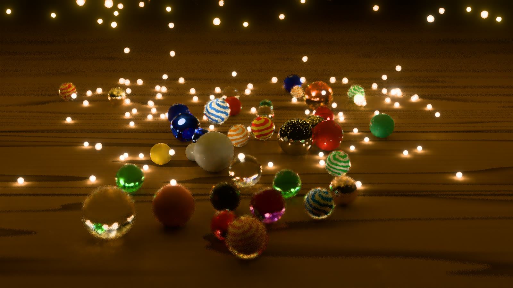
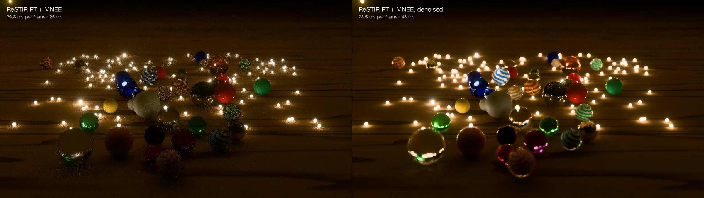

# Milestone 3: turning samples into an image

*Twenty seconds into the opening: ReSTIR PT and manifold next event
estimation traced at 960 × 540, denoised and upscaled to 1920 × 1080 by the
network described here.*

[Milestone 2](milestone-2.md) left me with better samples and a frame that
was still visibly noisy. Reusing paths made the light cheaper to find,
but the fireflies keep moving. I needed a way to turn those samples into
a moving image without waiting for thousands of them to accumulate.

That gave me a reason to build and train a model of my own. Serenity began
as a way to investigate GPU techniques that also matter to inference.
Now I could follow that connection through the whole process: produce
the training data, teach a network to reconstruct the image, and write
the kernels that run it inside the renderer. The result would be visible
in the marbles, including whatever the model lost or got wrong.

I also wanted it to upscale. Tracing at half the width and height means
tracing a quarter as many pixels, leaving more of the frame budget for
reconstruction. The network now turns 960 × 540 samples into a 1920 × 1080
image. On my M3 Max, the fully lit frame takes 23.5 ms, down from Milestone
2's 39.8 ms, with much less noise.

## Learning what to keep

Averaging nearby pixels can remove noise, but it can also smear a marble
into the table. The useful decision is how much each neighbor should
contribute. I built a network that makes that decision from the noisy
light and the renderer's knowledge of the surfaces: their color,
orientation, depth and motion.

For each output pixel, the network assigns scores to nearby input pixels
and passes those scores through a softmax to get weights. Suppose a pixel
on the table has three neighbors: another table pixel, the edge of a
marble, and a stray bright sample. Scores of 2, 1 and −1 become weights of
about 0.71, 0.26 and 0.04. Their weighted average keeps mostly the table's
light, some of the edge's, and very little of the outlier's.

That is the score, softmax and weighted sum used in attention. Here the
scores come from the image features and the values are the noisy light
in a local neighborhood. Training teaches the network how to compute
those scores, so the filter weights change with what is in front of it.
An edge needs a different mixture from a patch of table.

The network can reach across three neighborhood spacings, which lets it
use more distant pixels where the surface allows it. It also decides how
much of its previous output to keep, using motion vectors to line that
image up with the current frame. Each input pixel supplies four output
pixels, with a separate set of filter weights for each. Upscaling is
therefore part of the reconstruction it learns.

## Giving it something worth learning

I wanted to know whether this would work on the marbles without teaching
the network that particular scene. I generated 40 other layouts with
different marbles, firefly swarms and camera positions, and added the
brass-sphere scenes. Four generated layouts were reserved for validation,
which selected the saved model during training. The original marbles
stayed out of both sets and became the test after training finished.

The noisy inputs came from the actual ReSTIR renderer. Reuse makes errors
persist between neighboring pixels and successive frames, so training on
ordinary path-traced noise would give the model a different problem from
the one it would encounter live. The target for each input was the same
instant rendered with 4,096 samples per pixel. Producing the 400 frames
of data took about four hours on the M3 Max.

I could also make the task easier without asking the network to learn
more. The renderer already knows the wood grain and the colored swirls
inside the cat's-eyes. I factor that surface color out of the noisy light
before filtering, then restore it at full resolution afterward. That
lets the network work on the lighting while the renderer supplies the
fine surface detail. It is another place where conditioning the values
passed into a model matters: removing a known source of variation leaves
less for the learned computation to account for.

Glass makes those inputs less straightforward. The surface in front of
the camera may be transparent, while the detail I want to preserve is
behind it. The feature rays follow glass and mirrors to a rough surface,
so the network gets information about what the pixel shows. That choice
helps it distinguish a change in the visible surface from a change in
the noise.

I trained two network sizes in PyTorch. Validation kept improving
alongside training, with no sign of overfitting in either run. The wider
network generally reconstructed the held-out marbles better, and after
watching both live I kept that one. It has about 543,000 parameters.
The [training notes](../research/2026-10-15-denoiser-training.md) keep the
architecture, training setup and full comparisons together.

## Making the model fit the frame

A trained model still had to share the GPU with the renderer. I chose to
run it as my own Metal compute kernels in the same encoder as the rest
of the frame. That gave me control over the memory layout and the work
between layers, with PyTorch's output as the reference for what the
kernels should compute.

The first version spent 162 ms in the denoise pass at the window's
3456 × 2234 output size. Many threads needed the same input pixels and
model parameters, but kept reading them separately from device memory.
I changed the convolutions to load a block into threadgroup memory,
where the threads working on it could share those reads. That brought
the pass to 57 ms under the same conditions.

The remaining work followed the same reasoning. The final scores only
exist to become filter weights, so I kept them on chip through the
weighted sum. Where a layer needed outputs from two earlier layers, I
let it read those buffers directly instead of copying them into a new
combined buffer. Half-precision storage reduced the bytes moved for
model parameters and intermediate values. This is the same kind of work
that makes attention kernels practical: arranging for the arithmetic to
use data while it is nearby, and avoiding intermediate writes whose
only purpose is to feed the next operation.

Those early timings shared the GPU with training. With the changes in
place and training finished, the denoise pass takes about 26 ms at the
window's size, or 7.5 ms for a 1920 × 1080 output. On the real frames used
to check it against PyTorch, over 99% of displayed pixels are identical;
nearly all the rest differ by one level of eight-bit color. The memory
savings from half precision leave very little visible numerical change.

## What survives the reconstruction

*Ten seconds into the opening. Left: Milestone 2's ReSTIR PT and MNEE at
1920 × 1080. Right: light traced at 960 × 540, then denoised and upscaled
to 1920 × 1080. The frame times quoted here are measured later in the
scene, at 120 seconds with all lights awake.*

The held-out marbles gave me the result I needed to keep going. Across
seven test sequences, reconstruction removed roughly two thirds of the
raw input's displayed error. The porcelain reads as porcelain, and the
wood grain and colored swirls remain visible through much less noise.
The noisy frame-to-frame boiling is reduced, though a slower shimmer
remains on the table.

I used Intel's Open Image Denoise as a quality comparison, running it on
each low-resolution frame and then upscaling the result. My network uses
previous frames and learns the upscale as well. Across those sequences,
that combined reconstruction had 18 to 38% less displayed error than the
Open Image Denoise route. The fully lit scene gives a closer look:

| Region, all lights awake (t = 120 s) | ReSTIR PT, upscaled | Open Image Denoise, upscaled | Serenity's network |
|---|---|---|---|
| Whole frame | 0.00462 | 0.00221 | 0.00163 |
| Glass and metal | 0.0280 | 0.0151 | 0.0095 |

*Displayed MSE against a 65,536-sample reference; lower is better. Each
route starts with the same 960 × 540 input and produces a 1920 × 1080
image. This table compares reconstruction quality, so it reports MSE
itself. Frame costs are reported separately rather than folded into
Milestone 1's error × time measure.*

The remaining errors give me specific things to work on. The table's
slow shimmer corresponds to 36 to 47% more frame-to-frame variation than
in the targets once all the fireflies are awake. I included a training
penalty for changes between frames, but it contributed less than 3% of
the total loss. Giving it more weight is something to test in the next
training round. Cleaner targets are another planned investment: the
4,096-sample images still have speckles inside the glass, even though
their measured error is much lower than the network's output.

Other losses begin before the network gets its input. The large,
out-of-focus marbles have ragged edges because the surface features come
from a single ray through the lens at each pixel. Tiny fireflies seen
through glass or reflected in metal can occupy less than one input
pixel, and emerge as soft glows instead of sharp glints. Those are useful
places to judge what lower-resolution tracing is costing me, beyond the
whole-frame error number.

## Next

At 1920 × 1080 the complete frame now takes about 23.5 ms, or 43 frames
a second. At the window's 3456 × 2234 it still takes about 77 ms, or 13
frames a second. The network accounts for 26 ms, the full-resolution
surface-color pass another 9 ms, and tracing and reusing the light at
half resolution about 41.5 ms. The
[implementation notes](../research/2026-10-15-denoiser-live.md) break down
those costs.

Tracing and reuse alone already exceed the entire budget for 60 frames
a second. With the reconstruction running, I can now measure those passes
as part of the complete pipeline and see what their samples contribute
to the final image. That is the next milestone: follow the time and the
memory traffic through reuse, with the same questions about stored work,
repeated reads and GPU scheduling that brought me to Serenity.
