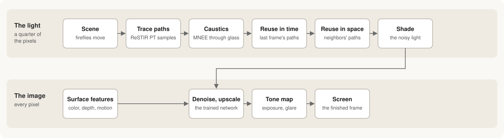
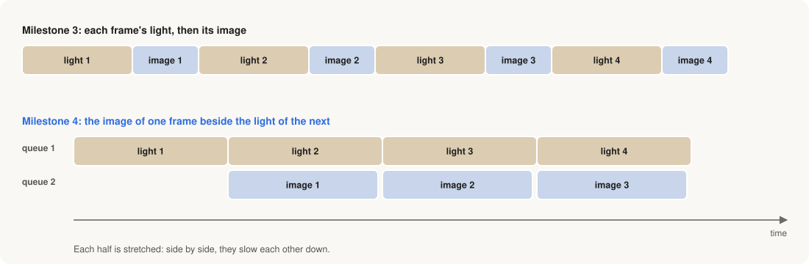
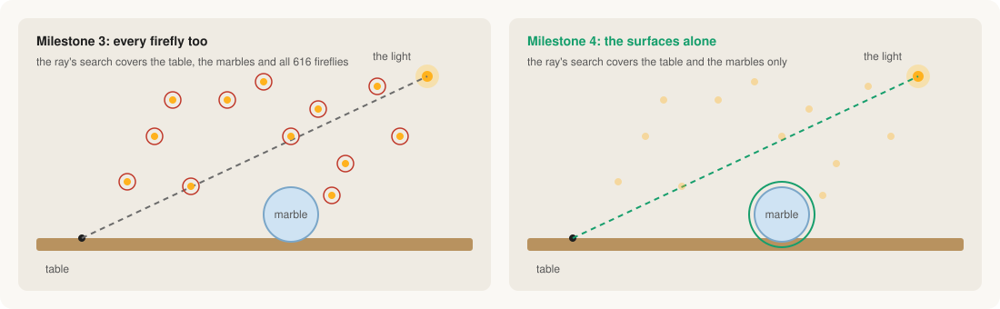
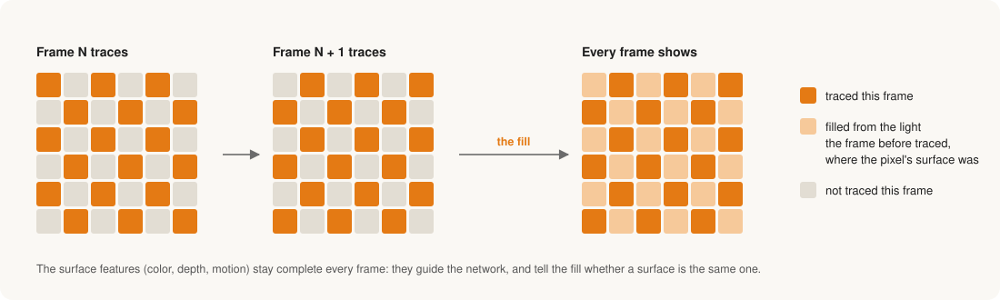
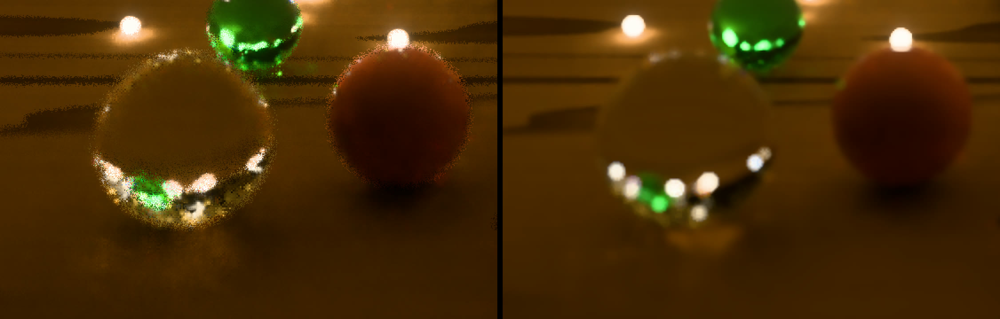
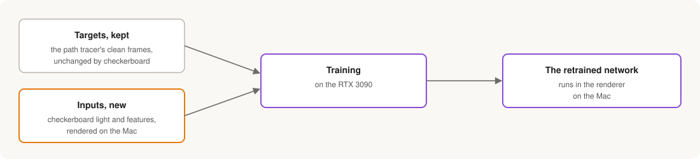

# Milestone 4: making the frame fast

*Twenty seconds into the opening, at 57 frames a second on my M3 Max.*

## Where Milestone 3 left the frame

[Milestone 3](milestone-3.md) finished the pipeline. Every frame now goes
from moving fireflies to a finished image:

The top row is the light, traced at a quarter of the output's pixels.
ReSTIR PT traces a few light paths for each pixel. Manifold next event
estimation (MNEE) finds the light that the glass marbles focus onto the
table. Each pixel then borrows good paths from its own previous frame and
from its neighbors. What comes out is still noisy.

The bottom row is the image. The renderer records what each pixel shows:
its surface color, orientation, depth and motion. The network I trained in
Milestone 3 uses those to decide how much each noisy neighbor should
count, removes the noise, and fills in the full resolution. A tone map
turns the light into display colors.

That frame looked mostly right. It ran at about 43 frames a second at
1920 × 1080, and about 13 at the full size of my laptop's display.

## What this milestone set out to do

Once a renderer produces the right image, the next work looks much the
same in most engines. They keep what the pipeline computes, and change how
much of it is computed each frame and how well the GPU is kept busy while
doing it.

This milestone applied four of those standard optimizations to the
Milestone 3 pipeline and kept three. Then a closer look at the marbles
sent me back over every stage of the frame, comparing each with how
shipped engines build it, and that added four more changes. Finally, I
retrained the network for the input that had changed. Here is the same
frame, with each change marked where it acts:

## Running the light and the image at the same time

A GPU has different kinds of hardware: units that test rays against the
scene, units that do arithmetic, and memory. Most passes lean on one of
them and leave the others waiting. Engines, consoles above all, put
independent work on a second queue so it can run in those gaps. This is
usually called async compute.

Serenity's frame splits that way. Tracing the light keeps the ray-tracing
hardware busy, and the network is almost entirely arithmetic. So the
network now works on one frame while the light of the next is traced:

Each frame's data is kept separate, so neither half overwrites what the
other is still reading. The image is unchanged. The price is a little more
latency.

It helped, but much less than the GPU's counters suggested, because the
two halves slowed each other down. My reading, not yet confirmed, is that
the arithmetic units looked idle without being free. Each core's threads,
registers and on-chip memory are one pool, and the ray-tracing work holds
its share of that pool while it waits for the ray-tracing unit.

The same question comes up in inference whenever two kernels are
overlapped to fill each other's gaps. A utilization counter shows what is
idle, not what is available.

## Shadow rays that skip what cannot cast a shadow

Engines tag geometry by kind and let each ray skip the kinds it does not
care about. Particles, foliage and small effects are commonly left out of
shadow rays, which only need to know whether anything blocks the light.

In Serenity, 616 of the scene's 653 objects are fireflies a millimeter or
two across. A firefly's own shadow is almost never visible, yet every
shadow ray still had to search among all of them. Now shadow rays search
only the 37 surfaces, the table and the marbles:

Metal's version of this feature works on a scene layout Serenity doesn't
use, and adopting that layout made every ray slower. So I built a second
ray-tracing structure holding only the surfaces, once at start-up, since
none of them moves. The image changes only where a firefly resting on the
table used to shade the wood beside it.

The usual companion is splitting the scene into a still part and a moving
part, so only what moves is rebuilt each frame. Here rebuilding the
fireflies was already nearly free, and the layout that split needs is the
one that slowed every ray on Metal, so I skipped it. It comes back with the
Vulkan and Xbox backends, where that layout is the hardware's normal case.

## Tracing half the pixels each frame

Checkerboard rendering traces half the pixels each frame, alternating like
the squares of a checkerboard, and rebuilds the other half from the frame
before. Consoles used it to reach 4K, and NVIDIA's RTXDI has a checkerboard
mode for ray-traced lighting. I read RTXDI's source and followed it.

The light is the expensive half of Serenity's frame, so the light is
traced in a checkerboard:

A new fill stage rebuilds each untraced pixel. It takes the light the
previous frame traced where the pixel's motion says its surface was, if
the depth there agrees, and otherwise borrows from the traced pixels beside
it. The surface features stay complete every frame, because they are what
lets the fill tell whether a surface is the same one.

My first attempt reused the whole previous image, filled pixels included,
and the untraced half drifted darker frame by frame. Taking only pixels
that were actually traced fixed it. The image came out a little smoother
and a little softer.

## Checking the whole frame against shipped engines

With those three in place, I looked at the marbles up close. The large
ones nearest the camera had ragged, speckled outlines, and had since
Milestone 3. The marbles further back were clean.

The cause was where the blur came from. Serenity made its depth of field
the way an offline renderer does: every pixel's ray passes through a
random point on a lens, every frame. At a blurred edge, a single ray lands
on the marble or on the table at random, so the surface information the
network relies on flickered between the two from pixel to pixel, and the
network kept that speckle as if it were a real edge. The near marbles are
the most out of focus, so they suffered most.

Real-time engines don't blur inside the trace. They trace a sharp image,
denoise it, and apply depth of field afterward, using each pixel's depth.
I had checked each optimization against production practice, but never
the camera. So I went over every stage of the frame against how Unreal,
NVIDIA's RTXDI and denoisers, and Apple's own samples do it, and kept four
changes:

- **Depth of field after the network.** The light is traced sharp, and a
  new stage blurs the finished image by each pixel's distance from focus,
  following the method from *Call of Duty: Advanced Warfare*, at half
  resolution as shipped games run it.
- **A fixed jitter pattern.** Upscalers like DLSS shift the camera by a
  fraction of a pixel each frame along a fixed sequence and tell the
  network the offset. Serenity's network upscales, so it now gets the same.
- **Brighter lights drawn more often.** RTXDI picks which lights to sample
  in proportion to their power, so noise moves away from dim fireflies
  that barely matter.
- **Frames paced by the display.** The window now renders when the display
  asks for a frame, as Apple recommends, behind a seam that a Vulkan or
  Xbox backend can implement its own way.

## Teaching the network the new input

Checkerboard, the sharp trace and the jitter all change what the network
sees, so I retrained it on a new data set. The targets it learns toward
come from the path tracer, which now renders them sharp too, so this time
everything had to be rendered again:

That was also where I found a mistake of my own. A first retrain I
believed was on checkerboard input wasn't: the graph that renders the
training inputs traced every pixel, because only the demo itself
switched checkerboard on. Training data has to be exactly what the
network sees at run time. So the input graph now traces the way the demo
does, and a test checks that the two match, bit for bit, before anything
is rendered.

This was the first training run on my RTX 3090. Training now runs on
either GPU, keeping its data on the card when it fits and in system
memory when it doesn't, as on the 3090. On the held-out marbles the
retrained network has 22 to 41% less error than Intel's Open Image
Denoise.

## Where it stands

The fully lit scene now runs at 57 frames a second at 1920 × 1080 on my
M3 Max, up from 43, and about 17 at my laptop display's full size, up
from 13. Tracing half the pixels gained the most. Depth of field gave a
little back, and was worth it: it is what made the near marbles look like
glass instead of noise. Running the two halves together gained the
least, and taught me the most.

The network and the reuse steps are now the larger costs. The reuse steps
merge reservoirs much as attention merges partial softmax results, and so
far I have treated them as passes rather than as kernels. Their tiling,
data layout and fusion are the questions that brought me to Serenity.

Those answers depend on the hardware, though. Apple's GPUs, NVIDIA's and
AMD's each have their own on-chip memory, register budgets and ways of
grouping threads, so a kernel tuned for one is not tuned for the others.
FlashAttention is the familiar example: the same algorithm, its kernels
rewritten for each GPU generation. Tuning the reuse steps on Metal alone
would mean doing it again later.

So the next step is for Serenity to leave the Mac. A Vulkan backend will
put the same scene on my RTX 3090 and AMD's Strix Halo, and a Direct3D 12
backend on the Xbox Series X, where the split scene and console async
compute come back into play. Then the reuse steps can be tuned as
kernels, for each of them.
