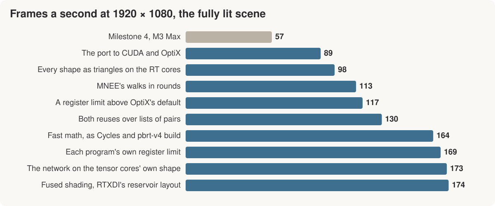

# Milestone 5: the frame on an NVIDIA GPU

*Twenty seconds into the opening on my RTX 3090 Ti. The fully lit scene,
measured later in the sequence, runs at 174 frames a second at 1920 × 1080.*

[Milestone 4](milestone-4.md) left Serenity running at 57 frames a second
on my M3 Max. I wanted to know how much of the renderer's design belonged
to that GPU. The scene and the trained network could stay; how their work
should be arranged was a question for the next machine.

The first port to my RTX 3090 Ti ran at 89 frames a second. By the end of
this milestone it ran at 174, on the same card.

I changed the plan before starting. Instead of Vulkan for rendering, I
chose CUDA and OptiX, so I could work directly with NVIDIA's tools and
instructions, including the ones used for inference kernels. The passes
came over one at a time, checked beside the Mac's image. Vulkan has one
remaining job: presenting CUDA's finished frame in the Linux window.
With that baseline working, I could start changing the design.

## When the geometry changed the light

Almost everything in Serenity is a sphere, but the 3090 Ti's ray-tracing
cores test triangles in hardware. My exact sphere intersections needed
a program on the ordinary cores. Replacing the spheres with fine
triangle meshes let those tests stay on the ray-tracing cores and made
the frame about 10% cheaper.

Then I tried fewer triangles. The outlines still looked round, but the
lighting changed first. With the coarsest meshes, the scene was 4%
darker. The porcelain lost light and the colored cores looked duller
through the glass. Small changes in surface geometry matter when rays
skim it or pass through it, even when the outline looks right.

Those meshes bought at most another 3% in speed. I kept the fine ones,
whose gap from the sphere stays below a thirtieth of a pixel at the
largest size I render. The faster intersections were worth keeping;
the darker marbles weren't.

## Keeping the unfinished work together

The next large cost was finding light paths through glass. Manifold next
event estimation, or MNEE, adjusts a candidate path step by step until
it finds a route from the surface to the light. Some searches finish
quickly. Others keep trying and never find one.

NVIDIA's GPU runs threads in groups of 32. A few unfinished searches can
keep a group occupied while the finished threads have nothing to do.
Here, a fifth of the searches failed but consumed 57% of all the steps.

I changed the scheduling so each search takes a few steps, then the ones
still going are gathered into fresh groups for the next round. Each
search does the same work, with fewer idle threads beside it. MNEE fell
from 2.6 ms to about 1 ms.

Reusing paths benefited from sorting too. A pixel borrowing a neighbor's
path may need to reconnect part of it or trace a portion again. Following
*ReSTIR PT Enhanced*, I put those jobs onto separate lists, so threads
in a group would be doing the same kind of work.

That made splitting the initial path tracer worth trying. Blender's
Cycles uses a wavefront design: small kernels advance paths through
separate stages, with sorting between them. My version kept more threads
busy, but slowed the frame to 141 frames a second against 164 with the
same math settings.

Every split meant saving a path's working state to memory and reading
it back in the next kernel. For Serenity's short paths on this card,
that traffic, sorting and extra launches cost more than the better
grouping saved. I kept the initial trace in one program, and the separate
lists where they paid for themselves.

## What precision does the image need?

The largest single gain came from a compiler setting. Cycles and pbrt-v4
build their GPU kernels with fast math, allowing cheaper approximations
for operations such as division and square root. Enabling it brought
Serenity from 130 to 164 frames a second.

In the comparison frame, 61% of pixels changed, mostly by small amounts,
while average brightness moved by less than a fifth of one eight-bit
level. The GPU checks against the CPU passed at their existing tolerances,
and I compared the frames side by side before keeping it.

Arithmetic precision has a cost in inference too. Here the glass and
reflections gave me something visible to judge alongside the numerical
checks. The coarser meshes had already shown that a small speed gain
could cost more of the image than I wanted to give up.

## Running the network as NVIDIA's hardware expects

The CUDA port already used tensor cores, but kept the small multiplication
blocks inherited from Metal. Following NVIDIA's CUTLASS convolution
kernels, I changed it to process sixteen input channels per instruction
instead of eight, and copy tiles directly into shared memory without
passing them through thread registers. The convolutions took 14% less
time. The changed summation order moved about 0.3% of the comparison
frame's pixels by one or two color levels.

The tracing programs also needed enough registers to hold their working
values without repeatedly spilling them to memory. I gave each program
its own limit, balancing that storage against how many threads could run
at once. Nearby pixels' saved paths were packed closer together too.

These are the inference questions that brought me to Serenity: which
instructions to use, how to arrange their inputs, and what to keep on
chip. The network's training and weights stayed the same throughout.
The implementation changed to fit the card.

## Where it stands

*The steps are in implementation order, measured on the fully lit scene
with the GPU otherwise idle. The last changes at 1080p are within the
variation between runs.*

The frame now takes about half the port's time at both output sizes:
174 frames a second at 1920 × 1080, and 50 at 3456 × 2234, up from 89
and 25. The [hardware-design notes](../research/2026-10-20-nvidia-hardware-design.md)
and [tracing measurements](../research/2026-10-21-tracing-divergence.md)
keep the full experiments, including the changes I dropped.

Next is AMD's Strix Halo through HIP and HIPRT. I want to see which of
these choices carry over, and where its thread grouping and memory
limits call for a different arrangement.
