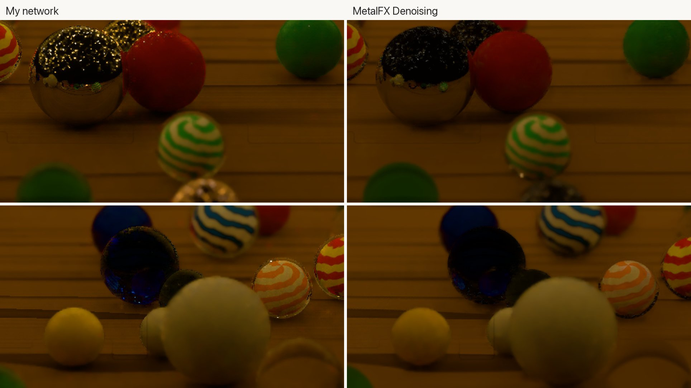
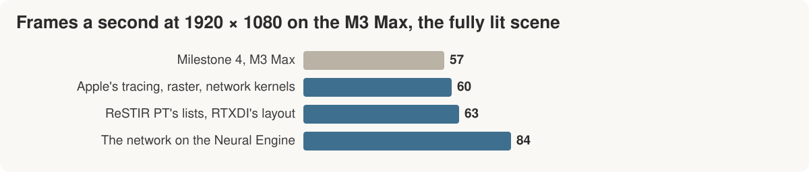

# Milestone 6: the frame on Apple silicon

*Twenty seconds into the opening on my M3 Max. The fully lit scene,
measured later in the sequence, runs at 84 frames a second at 1920 × 1080.*

[Milestone 5](milestone-5.md) redesigned the frame for my RTX 3090 Ti and
took it from 89 to 174 frames a second. The M3 Max was still running
[Milestone 4](milestone-4.md)'s design, nothing arranged for Apple's
hardware: 57 frames a second at 1920 × 1080 and 16 at the laptop's own
3456 × 2234. This milestone asked the Mac the question the last one asked
the 3090.

## What the profile showed

The denoiser was 43% of the frame at the larger size, its convolutions
running entirely in 32-bit arithmetic at about a quarter of the occupancy
the GPU aims for. Every pass that traces rays kept the M3's ray-tracing
unit 75 to 97% busy. Finding the first surface that isn't glass or a
mirror took 8.1 ms, almost as long as the whole path tree; on the 3090
it takes 0.74.

Rather than pick fixes one at a time, I took the production designs that
already run on this hardware and built them whole: Blender Cycles' Metal
backend for tracing, Apple's guidance for its GPU, and Intel's Open Image
Denoise for running a U-Net on Metal.

## The same change, the other result

Moving every sphere to fine triangle meshes made the 3090's frame 10%
cheaper. On the M3, following Cycles, it slowed every reuse pass by 16 to
29%, and Apple's advice to merge overlapping instances, which a pile of
marbles is, slowed it again. Cycles' way of seeding MNEE cost 3.3 ms on
the marbles, so I went back to the 3090's single traversal of the glass's
bounding boxes.

Apple's hybrid design rasterizes what the camera sees and traces only
where glass or a mirror sends the ray on. My first version was slower
than the rays it replaced, because the rasterizer drew all 12.6 million
of the fireflies' triangles twice a frame. Drawing each firefly at the
coarsest mesh within a thirtieth of a pixel, as raster engines do, fixed
that. The network moved onto Apple's own kernels in 16-bit, which was
only a little faster than mine: 5.73 ms against 6.23.

Those three changes took the frame from 57 to 60 frames a second, and
the 3090's scheduling and memory-layout work took it to 63. Every step
was production practice, and on this machine most were worth a few
percent.

## Apple's denoiser

MetalFX Denoising is Apple's own trained denoiser and upscaler. In the
frame it ran faster than my network, 77 frames a second against 63, and
lost what the scene is built around:

*The same frame, two crops. MetalFX loses the fireflies' pinpoints in
the mirrored marble and most of the light inside the blue glass.*

I kept my network.

## A second accelerator

The M3 Max also has a 16-core Neural Engine the frame never used. Apple's
guidance for rendering runs networks on the GPU, and I found the Neural
Engine only in shipping video upscalers, not renderers, so this was my
call rather than production's.

On its own the Neural Engine runs this network slower than the GPU,
6.46 ms against 5.97. What changes is that those milliseconds stop
belonging to the GPU:

The input sits in memory both units read, so nothing is copied. The
Neural Engine does need its shapes fixed in advance (a flexible model ran
five times slower), so the model carries 121 sizes and the frame pads up
to the next one.

The frame went from 63 to 84 frames a second at 1920 × 1080, and from 18
to 25 at 3456 × 2234. Only 0.3% of pixels differ from the GPU's result,
by at most two levels of 255.

This is the inference question that brought me to Serenity in its
plainest form: which unit on the chip should run the network, and what
does the hand-off cost. Here the round trip is about 0.6 ms more than the
network alone, and moving it off the GPU took a quarter off the frame's
time.

## Where it stands

*Measured on the fully lit scene with the GPU otherwise idle. The first
three changes were measured individually on a busy machine, so they are
shown together.*

Tracing the light now takes 11.27 ms of the 11.89 ms frame, most of it in
passes bound by the ray-tracing unit. A third frame in flight would
recover at most the half millisecond between light halves. I'm calling
this the limit for this frame on the M3 Max's ray tracing; the one
production design left untried here is Cycles' wavefront integrator,
which lost on the 3090. The
[design notes](../research/2026-10-23-apple-silicon-design.md),
[Neural Engine measurements](../research/2026-10-26-neural-engine-denoiser.md)
and [MetalFX comparison](../research/2026-10-27-metalfx-denoising.md)
keep the experiments, including the changes I dropped.

Next is AMD's Strix Halo through HIP and HIPRT, a third design for the
same frame.
